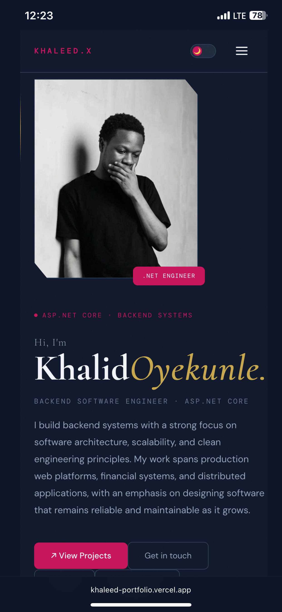

# Developer Portfolio


A modern, responsive portfolio built to showcase my backend engineering projects, technical experience, and software engineering journey.

The portfolio was designed with simplicity, performance, and maintainability in mind, serving as a central hub for my projects, résumé, and professional profile.

**Live Demo:** https://khaleed-portfolio.vercel.app

---

## Overview

This portfolio presents my work as a Backend Software Engineer, highlighting production-ready applications, distributed systems projects, and backend architecture while providing a clean and accessible user experience.

Rather than acting as a simple personal website, it reflects my engineering philosophy, technical growth, and approach to building maintainable software.

---

## Features

- Responsive design for desktop and mobile devices
- Dark/Light theme toggle
- Modern component-based architecture
- Engineering philosophy and professional profile
- Featured software projects
- Technical skills and technology stack
- Résumé download
- Contact information

---

## Design Principles

The portfolio was built with an emphasis on:

- Clean and intuitive user experience
- Responsive layouts
- Component reusability
- Maintainable codebase
- Performance optimization
- Professional presentation

---

## Tech Stack

### Frontend

- React
- Vite
- JavaScript
- HTML5
- CSS3

### Tools

- Git
- GitHub
- Vercel

---

## Project Structure

```text
src
├── components
├── assets
├── styles
├── App.jsx
└── main.jsx
```

---

## Running Locally

```bash
git clone https://github.com/khaleed-x/portfolio.git

cd portfolio

npm install

npm run dev
```

---

## Future Improvements

- Blog and technical writing section
- Case studies for engineering projects
- Project architecture diagrams
- Internationalization support

---

## Author

**Khalid Ayomide Oyekunle**

Backend Software Engineer

🌐 Portfolio: https://khaleed-portfolio.vercel.app

💼 LinkedIn: https://linkedin.com/in/khalid-oyekunle-54944230b
